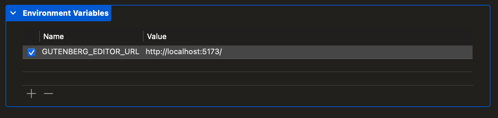

# Getting Started

This guide will help you set up your development environment for GutenbergKit.

## Prerequisites

In order to build GutenbergKit, the following tools must be installed on your development machine:

-   [Node.js](https://nodejs.org/en/download/) - Required for building the web app; recommend using [Node Version Manager](https://github.com/nvm-sh/nvm).
-   [Xcode](https://developer.apple.com/xcode/) - Required if building the iOS demo app.
-   [Android Studio](https://developer.android.com/studio) - Required if building the Android demo app.

## Development Commands

To see all available development commands, run `make help` (or simply `make`) in your terminal. This will display a list of all available build, test, and development commands.

## Web App

Install the GutenbergKit dependencies and start the development server by running the following command in your terminal:

```bash
make serve-dev
```

Once finished, the web app can now be accessed in your browser by visiting the URL logged in your terminal. However, it is **recommended to use a native host app for testing** changes made to the editor for a more realistic experience. A demo app is included in the GutenbergKit project, along with instructions on how to use it below.

## Demo App

This demo app is useful for quickly testing changes made to the editor.

### iOS

The iOS demo app loads the development server by default.

1. Start the development server by running `make serve-dev`.
1. Launch Xcode and open the `ios/Demo-iOS/Gutenberg.xcodeproj` project.
1. Select the `Gutenberg` target.
1. Run the app.

Alternatively, you can load a production build of the web app bundled with the GutenbergKit package by running `make build` and disabling the `GUTENBERG_EDITOR_URL` environment variable by navigating to _Product_ → _Scheme_ → _Edit Scheme_ in Xcode.

<details>
<summary>Example Xcode environment variable</summary>



</details>

### Android

Debug builds of the Android demo app load the development server at `http://10.0.2.2:5173/` by default.

1. Start the development server by running `make serve-dev`.
1. Launch Android Studio and open the `android` project.
1. Run the app on an emulator.

To load a different URL, set `GUTENBERG_EDITOR_URL` in the `android/local.properties` file. To load the production build of the web app bundled with the GutenbergKit package instead, run `make build` and set the variable to an empty value. Removing or commenting out the line restores the default, so only an empty value selects the bundled build. Rebuild the app after changing it.

<details>
<summary>Example Android local.properties</summary>

```
# Load the bundled production build
GUTENBERG_EDITOR_URL=
```

</details>

Release builds, and host apps that include a local GutenbergKit checkout, load the bundled build unless `GUTENBERG_EDITOR_URL` is set.

> [!NOTE]
> Android emulators route `http://10.0.2.2` to the host machine's IP address, allowing easy access to the development server from the emulator. For iOS simulators, the localhost URL is `http://localhost`. Appending the correct Vite development server port is required, which Vite logs when starting the server.
>
> To run the demo app on a physical device, see the [physical device setup guide](./physical-device-setup.md).

> [!NOTE]
> The development server serves only the translations fetched into `src/translations/`, so the editor renders in English until translations are fetched. To test translations, run `make fetch-translations`, then rebuild the app.

## Production Builds

To build GutenbergKit for production run the following command in your terminal:

```bash
make build
```
